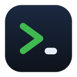

<p align="center">
  
</p>

<h1 align="center">Android Console</h1>

<p align="center">
  A fast, GPU-rendered terminal for <code>adb shell</code>, built in Rust with <a href="https://www.gpui.rs">GPUI</a>.
</p>

Android Console connects to an Android device over ADB and gives you an interactive shell with full 24-bit color, a scrollable back buffer and text selection. It runs on Windows, macOS and Linux.

## Features

- **Device management**
  - Lists attached devices with their state and transport (`usb`, `tcpip` or `emulator`).
  - Pick a device from a dropdown when several are attached.
  - Connect to a device over Wi-Fi by typing `host:port` (this runs `adb connect` for you).
  - Shows a clear error when `adb` is missing, no device is found, or a device is unauthorized.
- **Terminal emulation**
  - 16 ANSI colors, the 256-color palette and 24-bit truecolor.
  - Bold, dim, italic, underline and inverse text.
  - Cursor addressing, scroll regions, an alternate screen (for `vim`, `top` and similar) and UTF-8.
- **Scrollback**
  - Keeps the last 10,000 lines, so heavy `logcat` or `dmesg` output doesn't grow memory without limit.
  - Scroll with the mouse wheel, the scrollbar, or `Shift+PageUp` / `Shift+PageDown`.
  - New output follows you only while you're at the bottom. When you scroll back, your view stays put and a **Jump to live** button appears.
- **Selection and clipboard:** drag to select across visible and scrolled-back lines, then copy to the system clipboard.
- **Appearance**
  - High-contrast dark theme with a monospace font.
  - Adjustable font size, which is remembered between launches.
  - Block, underline or bar cursor, with optional blinking.
- **Clean shutdown:** disconnecting or closing the window kills the `adb` child process, so nothing is left running.

## Requirements

- [Android platform-tools](https://developer.android.com/tools/releases/platform-tools) (`adb`) on your `PATH`. Set the `ADB_PATH` environment variable if it lives somewhere else.
- A device with **USB debugging** enabled and authorized, or **wireless debugging** turned on.

## Install

Pre-built installers for each platform are produced by the [GitHub Action](.github/workflows/build.yml):

| Platform | Package |
|---|---|
| Windows (x64) | `android-console_<version>_x64-setup.exe` |
| macOS (Apple Silicon) | `android-console_<version>_aarch64.dmg` |
| Linux (x64) | `android-console_<version>_amd64.deb` |

The installers are not code-signed, so Windows and macOS will show a security warning on first launch.

## Usage

1. Plug in your device, or type `host:port` in the address box and press **Enter** (or click **Wi-Fi Connect**).
2. Choose a device from the device dropdown if more than one is listed.
3. Click **Connect**.

### Keyboard and mouse

| Action | Shortcut |
|---|---|
| Copy selection | `Ctrl+Shift+C` (`Cmd+C` on macOS), or right-click with a selection |
| Paste | `Ctrl+Shift+V` (`Cmd+V` on macOS), or right-click with no selection |
| Scroll history | Mouse wheel, scrollbar, `Shift+PageUp` / `Shift+PageDown` |
| Jump to top of history / back to live | `Shift+Home` / `Shift+End` |
| Increase / decrease / reset font size | `Ctrl+=` / `Ctrl+-` / `Ctrl+0` |
| Interrupt / end of input | `Ctrl+C` / `Ctrl+D` |

Arrow keys, `Home`, `End`, `PageUp`, `PageDown`, `Delete`, `Tab`, `Esc` and function keys are sent to the device as standard terminal sequences.

## Known limitations

- **No terminal resize:** the app never sends window-size information to the device, so the remote shell keeps its default width. Long lines may wrap differently on the device than in the window, and full-screen programs may not fill it.
- **Wide characters:** CJK and emoji take a single cell, so they can misalign.
- **Enter key:** Enter is sent as a line feed (`\n`), because the pty from `adb shell -tt` doesn't translate a carriage return.
- **Line editing:** arrow-key history and editing depend on the shell on your device; some stock Android shells don't provide it.
- **Dragging outside the window:** selection and scrollbar drags are only tracked while the pointer is over the terminal area.

## Building from source

You need a recent stable [Rust](https://rustup.rs) toolchain.

```sh
cargo run --release      # build and launch
cargo test               # unit tests
cargo test -- --ignored  # also run the live tests (needs an authorized device)
```

**Linux** also needs the GPUI build dependencies. On Debian/Ubuntu:

```sh
sudo apt-get install clang cmake pkg-config libssl-dev libasound2-dev libfontconfig-dev \
  libvulkan-dev libwayland-dev libx11-xcb-dev libxcb-xkb-dev libxkbcommon-x11-dev libxkbcommon-dev
```

**Windows** needs the MSVC build tools and a Windows SDK.

### Installers

Installers are built with [cargo-packager](https://github.com/crabnebula-dev/cargo-packager), configured in `Cargo.toml` under `[package.metadata.packager]`:

```sh
cargo install cargo-packager --locked
cargo build --release
cargo packager --release --formats nsis   # Windows
cargo packager --release --formats dmg    # macOS (set CI=true when running without a GUI session)
cargo packager --release --formats deb    # Linux
```

Output goes to `dist/`. To regenerate the icons, run `python scripts/make_icons.py` (needs Pillow).

## Project layout

| Path | Purpose |
|---|---|
| `src/term/` | Terminal state, VT/ANSI parser, cell grid and scrollback. No UI dependency, so it is unit-tested on its own. |
| `src/adb/` | Device discovery, `adb connect`, and the interactive `adb shell -tt` session with its reader and writer threads. |
| `src/ui/` | GPUI views: status bar, terminal rendering, scrollbar, key encoding and mouse handling. |
| `src/settings.rs` | Persisted settings (font size). |
| `vendor/xattr/` | Patched copy of `xattr 0.2.3`, needed to build on Linux with a current `libc`. |
| `assets/icons/` | Application icons. |

## Settings

The font size is stored in a plain-text file:

| Platform | Location |
|---|---|
| Windows | `%APPDATA%\AndroidConsole\settings.conf` |
| macOS | `~/Library/Application Support/AndroidConsole/settings.conf` |
| Linux | `~/.config/android-console/settings.conf` |

Delete the file to return to the default size.
